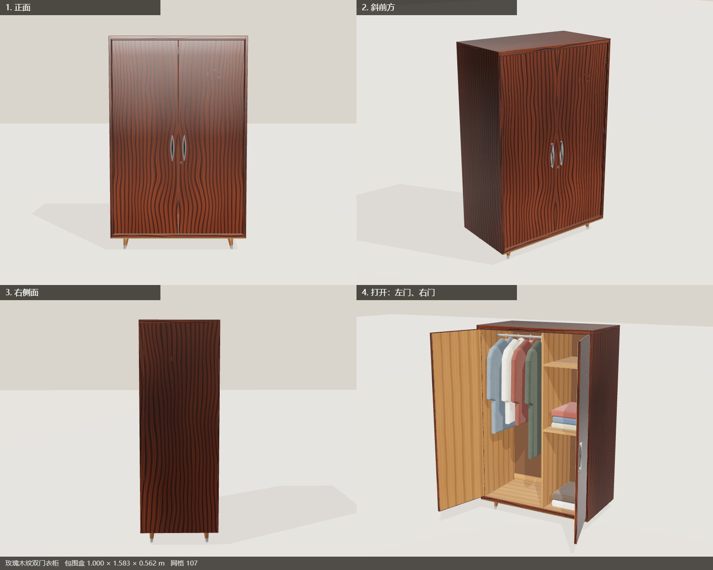

# 拾光回忆馆 · Memory Villa

扔掉旧东西之前拍张照片，上传到网页上，Claude 会对着照片把它**一砖一瓦地重建成 3D 模型**，
陈列在一座虚拟别墅里属于它的房间里——永久保存。



## 运行

前提：
- Node.js 18+
- 已安装并登录 **Claude Code**（`claude` 命令可用，用订阅账号登录）——生成模型走的是你的本地订阅额度
- Edge 或 Chrome（用于无头渲染预览图，让 Claude 对照照片自查）

```bash
npm install
npm start
```

然后打开 <http://localhost:5344>。Windows 下也可以直接双击 `start.bat`。

## 怎么用

1. **推门进入** → 别墅总览（屋顶揭开，像看娃娃屋一样俯瞰所有房间）
2. 点房间进入；点藏品近看；近看时点柜门/抽屉可以开合；`Esc` 返回上一级
3. 右上角 **＋ 收藏旧物**：拖入照片（多角度更好）、写下名字和回忆，交给 Claude
4. 右侧面板会实时显示 Claude 的建模过程；完成后藏品自动出现在房间里
5. 对模型不满意？在面板里写修改意见（"把手应该是黄铜色"），Claude 会在原模型上改

房间：卧室 · 客厅 · 书房 · 厨房餐厅 · 门厅 · 儿童房，中间是挂着所有原始照片的**回忆长廊**。
不指定房间时由 Claude 判断该放哪里。

## 生成流程

```
网页上传照片
  → data/items/<id>/photo.jpg + meta.json
  → 队列（一次一件）
  → claude -p --model claude-opus-5-5 --effort high   （本地 CLI，订阅额度；会剔除 ANTHROPIC_API_KEY 防止误走 API 计费）
      1. 读照片、建模规范 server/docs/MODEL_GUIDE.md、范例衣柜 model.js
      2. 写 analysis.json（名称/房间/年代/尺寸）和 model.js（程序化 Three.js）
      3. node server/tools/check-model.mjs   —— 校验能否构建、尺寸、面数
      4. node server/tools/render-preview.mjs —— 无头浏览器四视角渲染 preview.png
      5. 对照原照片看 preview.png，修改，再渲染……至少两轮
  → 服务器再校验一次（失败会让 Claude 最多修 3 轮）→ 入藏
```

每个模型都是纯代码（`export default function build(THREE, kit)`），不依赖任何外部素材；
`public/js/kit.js` 提供木纹/织物/噪声等程序化贴图、PBR 材质、圆角板件、车削体、管道、挤出，
以及 `kit.hinge` / `kit.slider` 可动部件。

## 数据与"永久"

- 所有藏品都在 `data/items/<id>/`：原始照片、`model.js`、`meta.json`、`preview.png`
- 网页上的"移出展馆"只会把文件夹移到 `data/trash/`，从不真正删除
- 备份 = 复制整个 `data/` 文件夹
- `.gitignore` 默认不把你自己的藏品提交进仓库（回忆是私人的），只保留两件示例

## 配置（环境变量）

| 变量 | 默认 | 说明 |
| --- | --- | --- |
| `PORT` | `5344` | 端口 |
| `SHIGUANG_MODEL` | `claude-opus-5-5` | 建模用的模型 |
| `SHIGUANG_EFFORT` | `high` | 推理强度 |
| `SHIGUANG_TIMEOUT_MIN` | `40` | 单件生成超时（分钟） |
| `CLAUDE_BIN` | `claude` | Claude Code 可执行文件 |
| `BROWSER_PATH` | 自动查找 | 渲染预览用的 Edge/Chrome |

URL 参数：`?room=bedroom` 直接进房间，`?item=<id>` 直接看藏品，`?lq` 关闭环境光遮蔽（低配电脑）。

## 目录

```
server/index.js            HTTP 服务、API、静态资源
server/generator.js        调用 claude CLI 的生成队列
server/docs/MODEL_GUIDE.md 给 Claude 的建模规范与 kit API
server/tools/              模型校验、无头渲染预览
public/js/main.js          渲染、相机漫游、交互
public/js/villa.js         别墅建筑（墙、门窗、灯、屋顶、花园）
public/js/rooms.js         平面布局与展位
public/js/items.js         藏品加载、摆放、展台、长廊照片、开合动画
public/js/kit.js           建模工具箱（浏览器与 Node 共用）
public/render.html         四视角棚拍预览
data/items/wardrobe-001/   示例：玫瑰木纹双门衣柜（手工精修）
```

示例藏品：
- `wardrobe-001` 玫瑰木纹双门衣柜（手工精修）——参考照片 Wikimedia Commons「Wardrobe (De Luz).jpg」，My Community Sg，CC BY 4.0
- `item-261002135604-ib4w` 胡桃木雕花大衣柜（由生成流水线全自动建模，用于验证流程）——参考照片 Wikimedia Commons「Armoire en noyer-Musée alsacien de Strasbourg (1).jpg」，CC BY-SA 4.0
